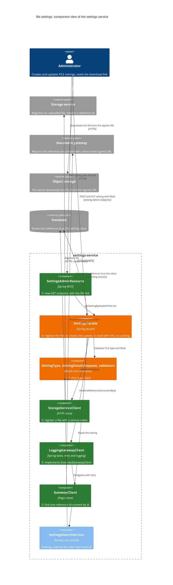

# file-settings: FILE setting type support
Status: ready

## Goal
Let an administrator attach an uploaded file to a setting. The settings service registers the file id with the storage service and keeps the returned reference id as the setting value.
Let an administrator read a `FILE` setting together with a temporary download link.

## Out of scope
- Metadata tables, history snapshots, and a `fileMetadata` request field.
- Rollback of `FILE` settings and reference checks during rollback.
- Idempotency keys, cache behavior, and change events for `FILE` settings.
- Client library changes.
- Virus scanning, and a separate error code for each failure.
- Batch endpoints. They stay metadata-only and reject `FILE`.

## Scope diagram (C4, component level)
Green = new, orange = changed, grey = unchanged or external. Numbers are subtask numbers.



Flows:
- **Create or update (subtasks 1 to 4):** the admin sends a `FILE` setting with `fileId`. The facade validates it, registers the file with the storage service, and stores the returned reference id as the value.
- **Read with link (subtasks 5 to 7):** the new admin endpoint reads the setting without caching. For a `FILE` setting the facade reads the reference document from the gateway and returns the signed URL as the value. The URL expires after about 5 minutes and is never stored.

## Subtasks

### 1. Add the FILE setting type
**Definition**
Add the value `FILE` to the `SettingType` enum, serialized as `file`.

**Recommendations**
- Use the existing style in `SettingType`.
- The error message for an invalid type lists the accepted values. Search the tests for the old list and update the expected text.

**Verification**
- Compilation: `mvn compile`.
- Unit tests: `.cursor/tools/verify-report.py --id file-settings`. Pass when the exit code is 0 and `verify-report.md` shows `Issues: none`.

### 2. Update the request model and its validation
**Definition**
Add the `String fileId` field to `SettingDetailsRequest`. Update `SettingKeyValidator` so a `FILE` setting may have a blank `value`. Update `SettingValueValidator` so a `FILE` setting is valid only when `fileId` is not blank.

**Recommendations**
- Use `StringUtils` for the blank checks.
- Check `FILE` before any early return for a null `value`. A `FILE` request normally has no value, so a null shortcut would hide a missing `fileId`.
- Batch operations do not accept `FILE`. Exclude it in the batch type subset annotation.
- Update the validator tests (extend the existing classes, use parameterized tests):
  - `SettingKeyValidator`: `FILE` with a null, empty, or blank `value` is valid. `STRING` with a blank `value` is still invalid.
  - `SettingValueValidator`: `FILE` with a non-blank `fileId` is valid for any `value`. `FILE` with a null, empty, or blank `fileId` is invalid.

**Verification**
- Unit tests and style: `.cursor/tools/verify-report.py --id file-settings`. Pass when the exit code is 0 and `verify-report.md` shows `Issues: none`.

### 3. Implement StorageServiceClient
**Definition**
Implement `StorageServiceClient`, an HTTP client that calls the storage service endpoint below to register an uploaded file for this service and returns the reference id.

**Recommendations**
- Place it in `src/main/java/com/example/settings/client`.
- Take the structure from the code below (try/catch, logging, exception). The path, body, and authentication come from the contract further down, not from the snippet.
```java
public class ExampleServiceClient {
    private static final String PATH = "/api/v1/example";

    private final RestTemplateWithRetry restTemplate;
    private final String serviceUrl;

    public String call(String id) {
        try {
            var response = restTemplate.exchange(
                    RequestEntity.post(URI.create(serviceUrl + PATH)).body(new Request(id)),
                    Response.class);
            log.atInfo().addKeyValue(ID, id).log("Called example service");
            return response.getBody().value();
        } catch (Exception e) {
            log.atError().setCause(e).addKeyValue(ID, id).log("Example service call failed");
            throw new ExampleException("Example service call failed for id=%s".formatted(id), e);
        }
    }
}
```
- Contract of the storage service endpoint (service token required):
```json
{
  "paths": {
    "/api/v1/internal/service/{serviceName}/references": {
      "post": {
        "summary": "Register uploaded files owned by a service and return reference ids.",
        "parameters": [
          { "name": "serviceName", "in": "path", "required": true,
            "schema": { "type": "string", "pattern": "^[a-z0-9]+(-[a-z0-9]+)*$" } }
        ],
        "requestBody": {
          "content": { "application/json": {
            "example": { "files": [{ "sourceId": "b1f4c0de-1234" }], "typeCode": "POLICY" } } }
        },
        "responses": {
          "201": { "content": { "application/json": { "example": { "referenceIds": ["ref-1"] } } } },
          "400": { "description": "Invalid request, or no storage location for the service and type code" },
          "401": { "description": "Unauthorized" },
          "403": { "description": "Not a service token" }
        }
      }
    }
  }
}
```
- Properties. Add the service name to `application.yml`. The type code has no default, so the environment must provide it. The service does not start without it. The base URL comes from the service registry property.
```yaml
app:
  file-storage:
    service-name: settings-service
    type-code: ${FILE_STORAGE_TYPE_CODE}
```
- Base URL: `${registry.storage.api}`.
- Validate the file id, base URL, service name, type code, and token before the call. Treat a missing body, an empty list, or a blank first id as an invalid response.
- Add `FileStorageException` (extends `SettingsException`), the entry `ErrorCode.FILE_STORAGE_ERROR("SET_FS_001", 502)`, and the constant `LogKeys.FILE_ID`.
- Unit test `StorageServiceClientTest`, in the `client` package. Cases: success (exact URL, bearer header, request body), trailing slash in the base URL, empty list, null list, missing body, blank id, transport failure keeping the file id and the cause, and each validation case. Follow `OtherClientTest` for the style.
- Update `.spec/docs`.

**Verification**
- Unit tests and style: `.cursor/tools/verify-report.py --id file-settings`. Pass when the exit code is 0 and `verify-report.md` shows `Issues: none`.

### 4. Add file registration to SettingsFacade
**Definition**
For a `FILE` setting, register the file during the create and update flows and store the returned reference id as the setting value.

**Recommendations**
- Depends on subtask 3.
- Use a private method `registerFile` with a guard clause for other types. It calls `StorageServiceClient` with `fileId` and writes the result into the change request.
- Call it in `createSetting` and `updateSetting`, after validation and the lookup of the existing setting, and before the service persists the change.
- Update `SettingsFacadeTest`. Cases for create and for update: the file is registered before persistence and the value is stored; a storage failure stops persistence; no call when the setting already exists (create), does not exist (update), or the type is not `FILE`.
- The shared REST test base class builds a context with `SettingsFacade`. Add a `@MockitoBean` for `StorageServiceClient` there.

**Verification**
- Unit tests and style: `.cursor/tools/verify-report.py --id file-settings`. Pass when the exit code is 0 and `verify-report.md` shows `Issues: none`.
- Integration tests: `mvn test -Dtest='*ITest' -Dsurefire.failIfNoSpecifiedTests=false`. Pass when all pass.

### 5. Add the gateway client
**Definition**
Add the dependency on the gateway Feign library and create the `GatewayClient` bean with a logging and retry wrapper.

**Recommendations**
- Add the version as a Maven property.
```xml
<dependency>
    <groupId>com.example.libs</groupId>
    <artifactId>gateway-feign-client</artifactId>
    <version>${gateway-feign-client.version}</version>
</dependency>
```
- Place the classes in the `client` package.
```java
@GatewayFeignClient
public interface GatewayClient {
    ReferenceDocument findOneReferenceDocumentById(String id);
}

public interface ExtendedGatewayClient extends GatewayClient {
}
```
- `ExtendedGatewayClient` is the type of the wrapper. It keeps the Feign bean and the wrapper bean apart. Use `ExtendedGatewayClient` in the rest of the service, never the plain `GatewayClient`.
- The wrapper `LoggingGatewayClient` implements `ExtendedGatewayClient`, injects the Feign `GatewayClient`, logs the start, the end, and the failure of each call, and retries. Use the real method name in the log call.
```java
@Component
@Slf4j
public class LoggingGatewayClient implements ExtendedGatewayClient {

    @Autowired
    private GatewayClient client;

    @Override
    @Retryable(retryFor = Exception.class,
            maxAttemptsExpression = "${gateway-client.retry.attempts}",
            backoff = @Backoff(delayExpression = "${gateway-client.retry.delay}"))
    public ReferenceDocument findOneReferenceDocumentById(String id) {
        return callWithLogging(() -> client.findOneReferenceDocumentById(id), "findOneReferenceDocumentById");
    }
}
```
- Properties in `application.yml`. The library reads `gateway.base-url` itself. It has no default. The service registry property `registry.gateway.api` comes from the environment.
```yaml
gateway:
  base-url: ${registry.gateway.api}/v2/documents
gateway-client:
  retry:
    attempts: 3
    delay: 100
```
- Test `LoggingGatewayClientTest` with mocks: delegation, a returned document, an exception that is logged and rethrown. Follow `EventSendServiceTest`.
- Update `.spec/docs`.

**Verification**
- Unit tests and style: `.cursor/tools/verify-report.py --id file-settings`. Pass when the exit code is 0 and `verify-report.md` shows `Issues: none`.

### 6. Add the download link to the admin read flow in SettingsFacade
**Definition**
Create the method `getSettingByKeyWithFileLink`. For a `FILE` setting it returns the signed download URL as the value.

**Recommendations**
- Depends on subtask 5.
- Add a comment that only admins may use this method.
- Take the structure from `getSettingByKey`.
- Do not rate limit this method.
- Do not use any caching. Read the setting with the non-cached `settingsSearchService`, not `settingsCachedSearchService`. Do not put the setting, the reference document, or the link into any cache. The link is short-lived and must be fetched on every call.
- Add a private method `populateDownloadLink`. For a `FILE` setting it calls `ExtendedGatewayClient` with the stored reference id and takes `files[0].url` from the reference document. Other types are returned unchanged.
- Write the link into the response object only.
- When there is no reference document, or no URL in it, log the failure and throw the service internal exception. When the client fails after the retries, log it and throw the same exception. Follow the logging approach of `SettingsFacade`.
```json
{
  "id": "ref-1",
  "files": [
    {
      "name": "policy.pdf",
      "contentType": "application/pdf",
      "url": "https://files.example.com/bucket/key?signature=...&expires=300",
      "size": 48213
    }
  ]
}
```
- Update `SettingsFacadeTest`: success, no reference document (exception), no URL (exception), client exception (exception), and a non-`FILE` setting returned unchanged.
- Update `.spec/docs`.

**Verification**
- Unit tests and style: `.cursor/tools/verify-report.py --id file-settings`. Pass when the exit code is 0 and `verify-report.md` shows `Issues: none`.

### 7. Add the endpoint to SettingsAdminResource
**Definition**
Add the endpoint that returns a setting with the download link, backed by `getSettingByKeyWithFileLink`.

**Recommendations**
- Depends on subtask 6.
- Take the structure from `SettingsRetrievalResource.getSettingByKey`. The path is the same, under the admin resource.
- Keep the controller thin. Call the facade only.
- Update the sequence diagram under `documentation/diagrams/sequence`.
- Update `infrastructure/openapi.yaml`.
- Update `SettingsAdminResourceITest` with a test for the new endpoint. Follow the style of the tests in that class.
- Update `.spec/docs`.

**Verification**
- Unit tests and style: `.cursor/tools/verify-report.py --id file-settings`. Pass when the exit code is 0 and `verify-report.md` shows `Issues: none`.
- Integration test: `mvn test -Dtest=SettingsAdminResourceITest -Dsurefire.failIfNoSpecifiedTests=false`. Pass when all tests pass.
